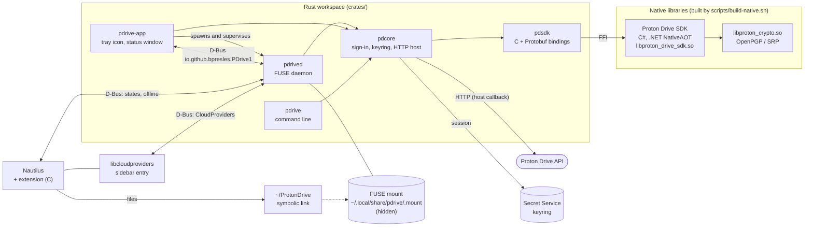

# PDrive for Linux

> **Unofficial third-party client, not affiliated with Proton AG.**
> PDrive for Linux is an independent personal project. It is not made, endorsed or supported by
> Proton AG. "Proton" and "Proton Drive" belong to their owners. It uses Proton's published
> Drive SDK and does not reuse any Proton logo.

PDrive for Linux gives Proton Drive a place in the Linux desktop: your "My files" folder is
mounted at `~/ProtonDrive`, files are downloaded when you open them, and Nautilus (GNOME Files)
shows their sync state, with a sidebar entry and a context menu.

Status: early alpha (the application identifies itself to Proton with the `-alpha` channel).

<!-- TODO(author): add screenshots, saved in docs/screenshots/ -->
<!-- TODO(author): docs/screenshots/nautilus-emblems.png - Nautilus with the state emblems -->
<!-- TODO(author): docs/screenshots/context-menu.png - "Keep Available Offline" / "Free Up Space" -->
<!-- TODO(author): docs/screenshots/sidebar.png - the "Proton Drive" entry in the Nautilus sidebar -->
<!-- TODO(author): docs/screenshots/status-window.png - the status window of pdrive-app -->
<!-- TODO(author): docs/screenshots/tray-menu.png - the tray icon and its menu -->

## Features

- **Mount of "My files"** with FUSE at `~/ProtonDrive` (configurable).
- **On-demand download**: a file is fetched when it is read, with progressive reading for large files.
- **Writes**: files are created, modified, renamed, moved and deleted from any application;
  new content is uploaded when the file is closed, with revisions. Interrupted uploads are
  resumed at the next start.
- **Live updates**: remote changes are applied from Drive events, with no repeated scan of the tree.
- **Thumbnails**: Proton thumbnails are written to the desktop thumbnail cache.
- **Local cache** of downloaded files, limited in size (10 GiB by default, least recently used
  files are dropped first, pinned files are kept).
- **Nautilus extension**: sync state emblems, and the context menu entries "Keep Available
  Offline" and "Free Up Space". Open windows are reloaded when the drive is mounted.
- **Sidebar entry** through libcloudproviders, with a menu (show status, open in the browser,
  mount / unmount).
- **Desktop application** (`pdrive-app`): tray icon, status window (account, used space,
  recent activity, "Open folder", "View online"), settings (mount point, cache size, sign out,
  start at login, open the window at start) and browser sign-in. It starts `pdrived` and
  restarts it if it fails.
- **Tray icon** through the StatusNotifierItem protocol: native on KDE Plasma, XFCE,
  Cinnamon, MATE, LXQt, waybar. **On GNOME, install and enable the
  "AppIndicator and KStatusNotifierItem Support" extension** (`gnome-shell-extension-appindicator`
  on Fedora, already installed on Ubuntu); otherwise the status window is shown with an
  explanation.
- **Translations** with gettext (French first, see `po/`).
- **Command-line tool** `pdrive`: `login`, `logout`, `status`, `ls [PATH]`, `selftest`.

The session is kept in the Secret Service keyring (GNOME Keyring, KWallet, ...). The
sign-in goes through your browser: PDrive never sees your password.

## Architecture



- The **SDK** is Proton's official C# Drive SDK, compiled with NativeAOT into a shared
  library and called from Rust through its C interface and Protobuf messages (`crates/pdsdk`,
  `native/proton.drive.sdk.proto`). The SDK does no network I/O itself: the HTTP requests go
  through a host callback implemented in `pdcore`, which adds the session headers.
- **`pdrived`** mounts the drive with FUSE in a hidden directory
  (`~/.local/share/pdrive/.mount`, ignored by GLib and gvfs so that the sidebar shows a single
  entry), and `~/ProtonDrive` is a symbolic link to it. It owns the content cache, the upload
  journal, the thumbnails and the D-Bus service.
- **D-Bus** (session bus, name `io.github.bpresles.PDrive`): interface
  `io.github.bpresles.PDrive1` (per-file state, offline pinning, account, quota, recent
  activity, mount / unmount) and the CloudProviders objects declared in
  `packaging/io.github.bpresles.PDrive.ini`.
- **`pdrive-app`** (GTK4 / libadwaita, application id `io.github.bpresles.PDrive.App`) runs and
  watches the daemon and shows its state. The daemon stops when the application dies.
- **The Nautilus extension** (`extension/`) asks the daemon over D-Bus for the state of the
  files it displays.

## Installation

### Requirements

- A recent Linux desktop (developed on Fedora; Debian-based systems should work with the
  equivalent packages).
- A Rust toolchain supporting edition 2024, and `pkg-config`.
- The **.NET 10 SDK**, to build the Proton SDK with NativeAOT (plus the C toolchain NativeAOT
  needs), and `git` (the sources of the SDK are fetched at a pinned revision).
- FUSE 3 (`fusermount3`).
- Development files of GTK 4, libadwaita and GLib, for `pdrive-app`.
- `gettext` (`msgfmt`) for the translations.
- A Secret Service provider (for example GNOME Keyring or KWallet).
- For the Nautilus extension: the development files of `libnautilus-extension-4`
  (`nautilus-devel` on Fedora) and GTK 4.
- On GNOME: the AppIndicator extension, for the tray icon (see above).

### From source

```sh
git clone https://github.com/bpresles/PDrive-for-Linux.git
cd PDrive-for-Linux

scripts/install.sh          # as your user
scripts/install-system.sh   # Nautilus extension and sidebar, needs sudo
nautilus -q                 # restart Nautilus to load the extension
```

`scripts/install.sh` builds the native libraries if needed (`scripts/build-native.sh`, which
clones the SDK into `third_party/`, so the first run takes a while), builds the Rust programs
in release mode and installs, under your home directory:

- `~/.local/lib/pdrive/`: the native libraries;
- `~/.local/bin/`: `pdrive-app`, `pdrived`, `pdrive`;
- `~/.local/share/applications/io.github.bpresles.PDrive.App.desktop`: the menu entry;
- `~/.local/share/icons/hicolor/`: application, tray and emblem icons;
- `~/.local/share/locale/<lang>/LC_MESSAGES/pdrive.mo`: translations.

`~/.local/bin` must be in your `PATH` to run the commands from a terminal. `scripts/install-system.sh`
builds the Nautilus extension and installs it in the extension directory of Nautilus, the
sidebar declaration in `/usr/local/share/cloud-providers/` and the translations of the
extension in `/usr/local/share/locale/`. It needs `sudo` because Nautilus and libcloudproviders
only read system directories.

### First start

1. Start **PDrive** from the applications menu (or run `pdrive-app`).
2. Click "Sign in": your browser opens for the Proton sign-in (the window mentions that this
   is an unofficial client). `pdrive login` does the same from a terminal.
3. The daemon mounts the drive at `~/ProtonDrive`; it is also in the Nautilus sidebar.
4. After the first sign-in, the application offers to start at login. You can change it in the
   settings (it creates `~/.config/autostart/io.github.bpresles.PDrive.App.desktop`).

### Packages

RPM and DEB packages are meant to be published with the releases of the repository:
see the [GitHub releases](https://github.com/bpresles/PDrive-for-Linux/releases). Details for
packagers are in `packaging/README.md`.

## Configuration

Settings are in `~/.config/pdrive/config.toml` (or under `$XDG_CONFIG_HOME`). The file is
optional; unknown keys are rejected. The settings window of `pdrive-app` edits the same file
and keeps your comments. Restart the application (or the daemon) after a manual change.

```toml
# Where "My files" is mounted ("~" is the home folder).
mountpoint = "~/ProtonDrive"
# Maximum size of the cache of downloaded files, in GiB.
cache_size_gib = 10
# Whether launching pdrive-app opens its status window (read by pdrive-app only).
show_window_at_startup = true
```

| Key | Default | Meaning |
| --- | --- | --- |
| `mountpoint` | `"~/ProtonDrive"` | Folder where the drive appears (a symbolic link to the hidden real mount). |
| `cache_size_gib` | `10` | Size limit of the cache of downloaded files, in GiB. |
| `show_window_at_startup` | `true` | Open the status window when `pdrive-app` is started by hand. It is never opened with `--background` (start at login). |

Other locations: the content cache and the pending uploads are under `~/.cache/pdrive/`; the
hidden mount and the list of pinned files (`pinned.json`) are under `~/.local/share/pdrive/`. Setting `PDRIVE_VERBOSE=1`
logs HTTP requests and SDK debug messages.

## Logs

Started from the menu or at login, `pdrive-app` and the daemon it runs log to the journal of
your session:

```sh
journalctl --user -t pdrive -f
```

Without a journal, the log is `$XDG_STATE_HOME/pdrive/pdrive.log` (by default
`~/.local/state/pdrive/pdrive.log`). From a terminal, they go to the standard error output.

## Known limitations

- File permissions and a modification date alone are not kept (Proton Drive does not store them).
- Files "Shared with me" and Photos are not handled.
- `O_NOATIME` is refused on files that are not in the cache.
- Deleting a file moves it directly to the Proton trash, not to the Nautilus trash.
- Rendering on KDE and GNOME, and the translated Nautilus menus, still need more real-world testing.

The roadmap is in `PLAN.md` (in French).

## Uninstall

Quit PDrive from the tray menu first (it unmounts the drive), then:

```sh
# User files
rm -f ~/.local/bin/{pdrive-app,pdrived,pdrive}
rm -rf ~/.local/lib/pdrive
rm -f ~/.local/share/applications/io.github.bpresles.PDrive.App.desktop
rm -f ~/.config/autostart/io.github.bpresles.PDrive.App.desktop
find ~/.local/share/icons/hicolor -name 'io.github.bpresles.PDrive.App.svg' -o -name 'emblem-pdrive-*.svg' -o -name 'pdrive-*.svg' | xargs -r rm -f
rm -f ~/.local/share/locale/*/LC_MESSAGES/pdrive.mo

# System files
sudo rm -f "$(pkg-config --variable=extensiondir libnautilus-extension-4)/libpdrive-nautilus.so"
sudo rm -f /usr/local/share/cloud-providers/io.github.bpresles.PDrive.ini
sudo rm -f /usr/local/share/locale/*/LC_MESSAGES/pdrive.mo
nautilus -q
```

Your data: `pdrive logout` first removes the session from the keyring and revokes it. Then,
if you want, delete `~/.config/pdrive/`, `~/.cache/pdrive/` (note: this loses uploads still
pending) and `~/.local/share/pdrive/`. Files stored in Proton Drive are not affected.
Remove the `~/ProtonDrive` link if it remains.

## Proton's terms for third-party apps

PDrive uses the official Proton Drive SDK and follows the conditions Proton sets for
third-party applications: it is presented as an unofficial client, uses no Proton logo,
sends an honest `x-pm-appversion` header (`external-drive-pdrive_for_linux@<version>-<channel>`)
and synchronises with Drive events instead of polling the tree. Proton announced a
cryptographic migration for the end of 2026 / early 2027: the SDK will have to be followed
and a release of PDrive may be needed. Please read Proton's current terms of service before using
or redistributing this software; you use it at your own risk.

## Licence

PDrive for Linux is free software, licensed under the
[GNU General Public License, version 3 or later](LICENSE) (`GPL-3.0-or-later`).

It builds on components published by Proton AG under the MIT licence (the Proton Drive SDK,
`dotnet-crypto` and `proton-crypto-rs`) and on other open-source dependencies. Their notices
are in [`THIRD_PARTY_NOTICES`](THIRD_PARTY_NOTICES).
